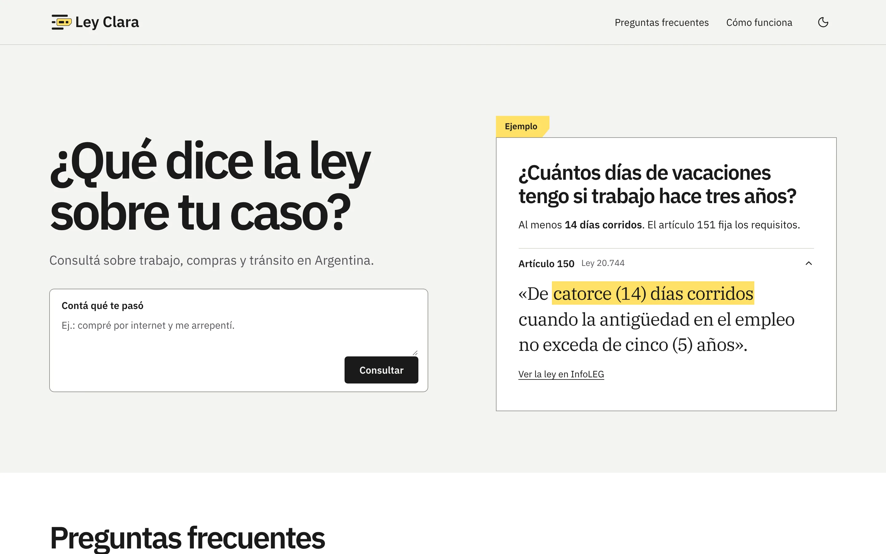
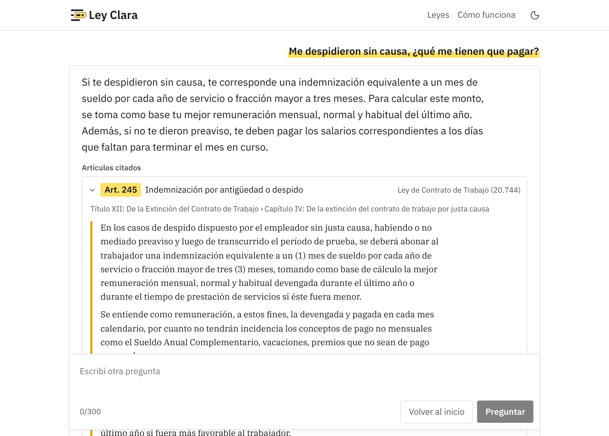
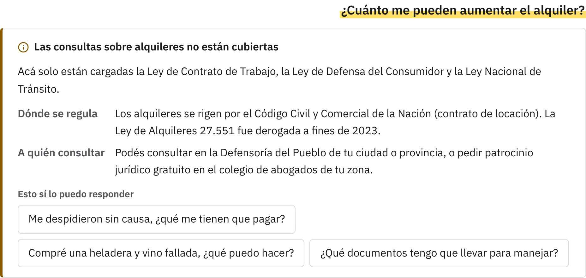

<h1>
  <picture>
    <source media="(prefers-color-scheme: dark)" srcset="public/brand/ley-clara-oscuro.svg">
    
  </picture>
</h1>

Ask in plain Spanish about your rights at work, as a consumer or on the road in Argentina, and get a short answer that cites the exact article of the law.



Most people start from a problem, like "me despidieron", "me vendieron algo fallado" or "me pararon en un control", and have no idea which law covers it. Ley Clara is organized around those situations, so nobody has to know. It searches the three laws it has, finds the articles that fit, answers in two or three sentences and shows the official text of each article it cites.

| Area | Law | Latest amendment included |
|---|---|---|
| Work | Ley de Contrato de Trabajo 20.744 | Ley 27.802 (Boletín Oficial, 6/3/2026) |
| Shopping | Ley de Defensa del Consumidor 24.240 | Ley 27.701 (1/12/2022) |
| Traffic | Ley Nacional de Tránsito 24.449 | Decreto 627/2025 (3/9/2025) |

The texts are the updated versions published by [InfoLEG](https://servicios.infoleg.gob.ar/), downloaded on 26/11/2026.



## How a question is answered

1. If the question is about a legal topic that isn't loaded (rent, divorce, pensions, work accidents), the site says where that topic is regulated and who to ask, without searching or calling the model.
2. Otherwise it searches all three laws at once. Everyday words are mapped to the law's words first, so "me echaron" also searches for "despido" and "indemnización". Ranking combines BM25 and pgvector similarity with reciprocal rank fusion.
3. If no article clears the relevance threshold, the model is not called. The user gets "no encontré un artículo que responda eso" with a few questions that do work.
4. If there are matching articles, Gemini gets those articles and nothing else, and has to return JSON with the answer and the ids it cited.
5. Citations are checked against the articles that were sent. An answer that cites anything else is dropped. The article text shown on screen comes from the parsed law. The model never writes it.



## Design decisions

### Why only three laws

Each one covers a common everyday problem and has one national text. A small scope made it possible to test the parser on every article, build a vocabulary for each area and say clearly what isn't covered. Rent was left out on purpose: Ley 27.551 was repealed at the end of 2023 and rentals now fall under the Código Civil y Comercial, which isn't loaded.

### Declining when there is no source

A legal answer that sounds right and is wrong can hurt someone, so the site would rather say it found nothing. The relevance check runs before the model, the prompt lets the model answer `not_found`, and the citation check runs after it.

### Topics the law excludes

"Soy empleada doméstica, ¿cuántas vacaciones tengo?" looks like a labor question, but article 2 of the Ley de Contrato de Trabajo excludes domestic work, which has its own law (26.844). Topics like that are rejected even when the question sounds covered.

### What Postgres is for

The law text ships with the app as JSON produced by the parser, so pages and BM25 don't depend on the database. Postgres holds what has to be shared or computed once:

- `chunk_embeddings`: one vector per chunk and embedding model, plus a hash of the chunk text. Search filters by model and ignores vectors whose hash doesn't match the current text, so vectors from two models or from an old version of a law are never compared.
- `kv`: the answer cache and the rate limit counters, shared by every serverless instance.

The same code runs against a local Postgres in Docker and against Neon in production. Only `DATABASE_URL` changes. Without it the app still works, with lexical search and limits kept in memory.

### Cost

Everything runs on free tiers. Embeddings are computed once by `npm run ingest`, which only embeds chunks that are new or changed. Each question costs one query embedding and at most one model call. Rejected questions and cached answers cost nothing. The LLM sits behind an interface ([src/lib/ai/types.ts](src/lib/ai/types.ts)), so switching to Groq, OpenRouter or a local Ollama model is a matter of environment variables. A mock provider quotes the best article and is what tests and CI use.

### Abuse

A daily limit per IP (stored as a salted hash), a global daily cap on model calls, an invisible Cloudflare Turnstile check, a 300 character limit on questions, and a token limit on answers. If Gemini returns 429, the site shows "demo agotada por hoy" and stops calling it until the next day. A 503, which means the model is busy, gets one retry a second later. Pages are served with a nonce-based Content-Security-Policy.

## Evaluation

```bash
npm run eval -- --verbose                   # provider and database from .env.local
npm run eval -- --set holdout --verbose     # questions never used for tuning
LLM_PROVIDER=mock npm run eval              # search and routing only, no model
```

[`eval/questions.json`](eval/questions.json) has 30 questions: 20 with an expected article, 3 off topic, 4 on uncovered legal topics and 3 that are covered but have no clear answer in the law. They are worded differently from the examples on the home page. [`eval/holdout.json`](eval/holdout.json) has 17 more, written after the everyday-language mapping was tuned and never used to tune it.

Results with `gemini-3.1-flash-lite` and hybrid search (BM25 plus `gemini-embedding-001` vectors in pgvector):

| | Main set | Holdout |
|---|---|---|
| Expected article in top 5 (what the model receives) | 100% (20/20) | 92% (12/13) |
| Expected article first | 90% (18/20) | 77% (10/13) |
| Right kind of response | 97% (29/30) | 94% (16/17) |
| Answers that cite an expected article | 100% (20/20) | 100% (12/12) |
| Answered when it should have declined | 1 | 0 |

With BM25 alone the expected article came first for 50% of the main set and 62% of the holdout, so the vectors mostly help with ranking. Full reports, question by question, are in [`eval/results/`](eval/results/).

Two questions fail:

- "¿Cuánto sale exactamente la multa por estacionar mal en Rosario?" is expected to be declined. The model explained that fines are set in UF, each worth a liter of nafta especial, between 50 and 5,000 UF, and that the law sets no amount per city. That is correct, but the question asked for an exact figure, so it counts as a miss.
- "Mi empleador me debe dos meses de sueldo, ¿puedo considerarme despedido?" (holdout) needs articles 242 and 246 of the Ley de Contrato de Trabajo. They rank 7th, outside the five articles the model sees, so the site says it found nothing.

The certificates, inheritance and retirement questions that failed with BM25 alone now route correctly: the vector score lets the first one through, and Gemini declines the other two.

Answers took 2 to 4 seconds on average. During the run the free tier was overloaded and some requests timed out after 25 seconds. The runner tries those questions again after a 30 second pause, and the report lists any that still fail.

## Running it locally

You need Node.js 20 or newer. Docker is optional, for the database.

```bash
npm install
cp .env.example .env.local        # add GEMINI_API_KEY, free at aistudio.google.com
docker compose up -d              # local Postgres with pgvector
npm run db:setup
npm run ingest                    # parses the laws and stores embeddings
npm run dev
```

Without a key the site answers by quoting the best article and says so on the page. Without Docker, leave `DATABASE_URL` empty.

To refresh the laws from InfoLEG, run `npm run ingest -- --fetch`. Adding a law, such as the Constitution, means adding it to [src/config/laws.ts](src/config/laws.ts) and running the same command.

## Deploying

On Vercel the `vercel-build` script runs `npm run ingest` before `next build`, so every deploy creates the tables if they're missing and embeds the chunks that are new or changed. The first deploy takes about six minutes longer because of the free tier limit on embeddings. If the database or the embedding API is down, the build goes on and search uses BM25 until the next deploy.

## Tests

```bash
npm test                                   # parser, search, routing, limits, cache
TEST_DATABASE_URL=postgres://... npm test  # also runs the Postgres tests
npm run e2e                                # Playwright, desktop and mobile
npm run lint && npm run typecheck
```

CI runs all of the above against a pgvector service, checks that the committed law JSON matches the parser output, and runs the evaluation with the mock provider.

## Project layout

```
src/config/        laws, areas, frequent questions, site name and limits
src/lib/ingest/    InfoLEG HTML to articles, with amendments and dates
src/lib/retrieval/ Spanish text processing, BM25, vector search, hybrid ranking
src/lib/scope/     everyday words, area hints, uncovered topics
src/lib/ai/        LLM and embedding providers behind one interface
src/lib/assistant/ prompt, answer pipeline, request handling
src/lib/db/        Postgres client, schema, embeddings
src/lib/guard/     rate limits, cache store, Turnstile
src/app/           pages and the /api/ask route
data/              InfoLEG HTML as downloaded, and the parsed laws
eval/              test questions, runner and reports
e2e/               Playwright tests
```

Code and comments are in English. Terms that come from Argentine law (`trabajo`, `título`, `Boletín Oficial`, `vigencia`) stay in Spanish, and so does everything users see.

## License

[MIT](LICENSE)
